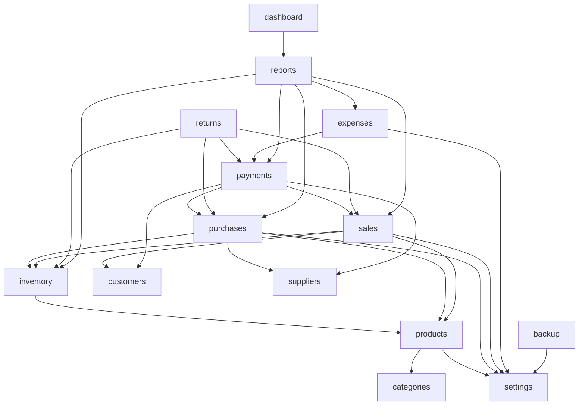

# Feature Dependencies (domain level)

`A --> B` means A's domain depends on B's domain contracts.

The graph must stay acyclic. `reports`/`dashboard` are read-only consumers via query contracts. `payments` reads invoices through `InvoiceBalanceReader` and never edits them. `expenses` only reuses the payment-method contract of `payments` (it does not create payments).

## Build order
settings (minimal, Phase 1) → categories/units/products → inventory → purchases → sales → payments → returns → expenses → reports/dashboard → backup → settings (full, Phase 11).

## Phase 2 notes
Units belong to the `products` feature. `CurrencyConfig` is part of the shared kernel (`shared/domain/value_objects`). The `settings` feature currently exposes only currency reading and tax-rate creation; `products`, `customers` and `suppliers` depend on it through domain contracts (`SettingsRepository`, `TaxRateRepository`).

## Phase 3 notes
`inventory` depends on `products` (via `ProductRepository`, `UnitRepository`) and `settings`, as planned. The shared kernel gained `shared/domain/audit` (audit entry + repository contract) and `shared/data` (Drift audit implementation).

Presentation-level exceptions: the customer detail screen shows the receivable through the sales domain use case `GetCustomerReceivable` (customers presentation -> sales domain), and the supplier detail screen shows the supplier payable through the purchases domain use case `GetSupplierPayable` (suppliers presentation -> purchases domain). Domain layers stay acyclic.
