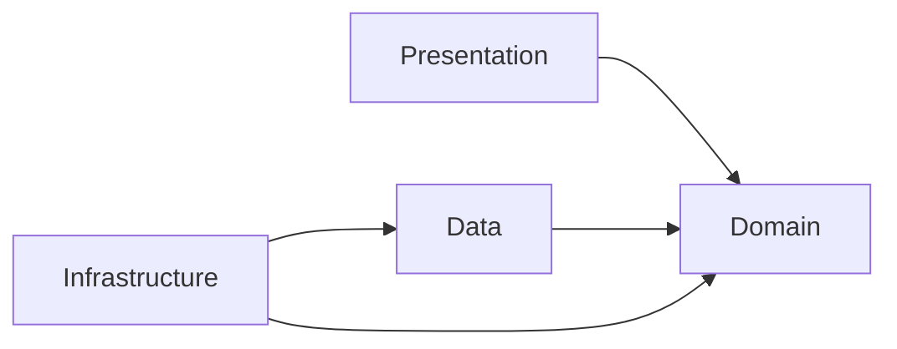
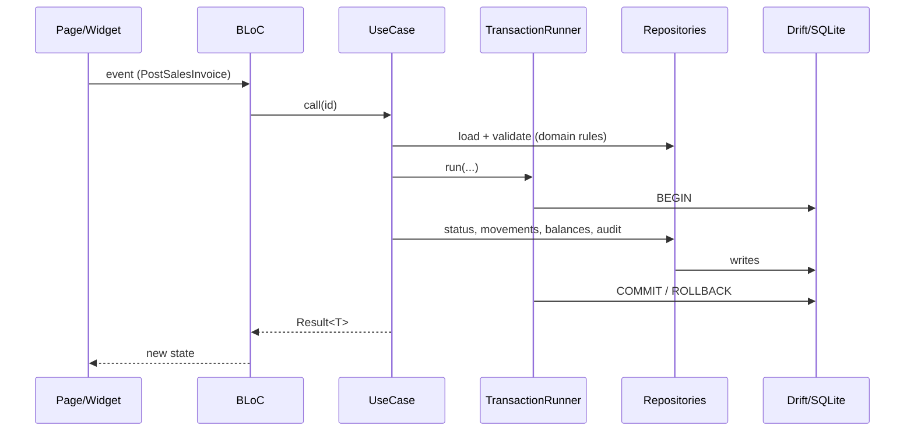

# Inventrix — Architecture Overview

**App:** Inventrix · **Package:** `inventrix` · **ID:** `com.rk.inventrix` (Android + iOS)
**Nature:** offline-first, single-device, no authentication, all data in local SQLite (Drift).

## 1. Layers

| Layer | Contains | May depend on |
|---|---|---|
| Presentation | pages, widgets, BLoC/Cubit, UI state | Domain |
| Domain | entities, value objects, repository contracts, use cases, domain services, rules | nothing (pure Dart) |
| Data | repository implementations, datasources, Drift row models, mappers | Domain, Infrastructure |
| Infrastructure | Drift database, file system, PDF, backup/restore, platform plugins | Domain contracts |

Domain is pure Dart: no Flutter, Drift, or plugin imports. `app/di` is the only place that wires concrete classes to contracts.

## 2. Key decisions (see `decisions.md` for rationale)

1. **Money** = `int` minor units + currency code + decimal places. No `double`, and **no `decimal` package** (integer arithmetic with explicit rounding is sufficient and removes a dependency).
2. **Quantity** = `int` in fixed scale 10^3 (milli-units). Each unit restricts input to 0–3 decimal places.
3. **Ledger is truth.** `stock_movements` is append-only; `inventory_balances` is a projection updated in the same transaction and reconcilable.
4. **Inventory valuation** = Weighted Average Cost via **value tracking** (`quantity_on_hand` + `inventory_value_minor`) to avoid rounding drift from a stored unit cost.
5. **Transactions** via a domain `TransactionRunner` contract implemented over Drift's `transaction()`; use cases own the transaction boundary, repositories participate implicitly.
6. **Document status and payment status are separate.** Payment status is derived, never stored.
7. **Posted documents are immutable.** Corrections are reversals/compensating entries.
8. **Cross-feature coordination** happens only through domain contracts and use cases, never BLoC-to-BLoC or data-layer imports.

## 3. Runtime flow

## 4. Error model
`Result<T>` (Success/Err) + sealed `Failure` hierarchy: `ValidationFailure`, `DatabaseFailure`, `NotFoundFailure`, `InsufficientStockFailure`, `DuplicateEntryFailure`, `BackupFailure`, `RestoreFailure`, `UnexpectedFailure`. Repositories translate exceptions; BLoCs map failures to user-facing messages. No raw SQL or stack traces reach the UI.
