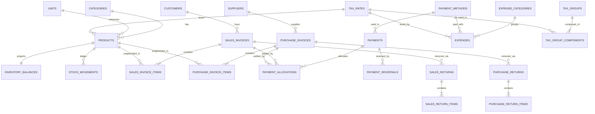

# ER Diagram

`business_profiles`, `app_settings`, `document_sequences` (purchase numbers use it since v4), `audit_logs`, `attachments` (owner is referenced by `owner_type` + `owner_id`, guarded by triggers; expense receipts for now), `backup_history` are standalone (no FK edges) and omitted for clarity. Sales/purchase items → products is a *snapshot* relationship (FK kept for traceability, values copied).
