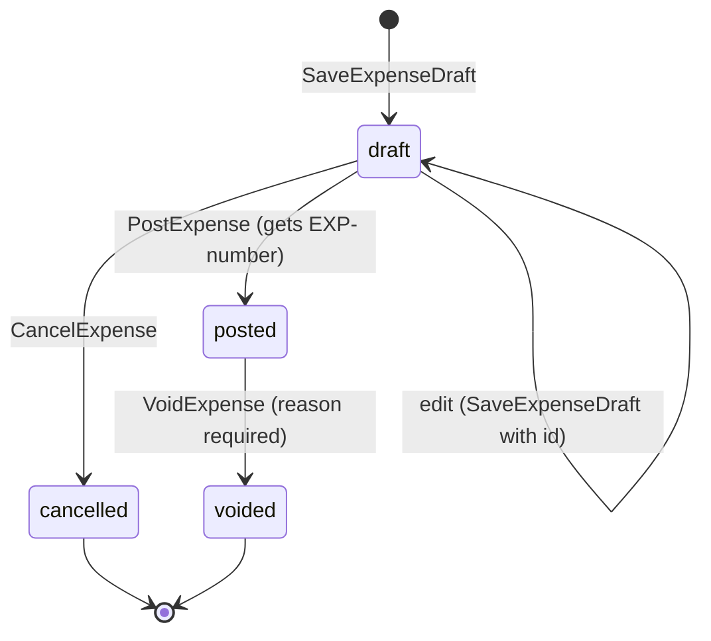

# Expenses Workflow

An expense records money the business spent: rent, utilities, transport, supplies. It is a **numbered document** (`EXP-000001`) with a draft → posted → voided lifecycle. Expenses **do not touch inventory** and are **not payments** in the Phase 6 sense (they are not allocated to invoices); each one is simply paid with a payment method.



## Rules
- **Draft** has no number and does not count anywhere. It can be edited, posted or cancelled. A cancelled draft is kept (filter "Cancelled"); nothing is ever deleted (a database trigger forbids it).
- **Posting** runs in one transaction: re-read the expense, require status `draft`, re-check its integrity (`ExpenseIntegrity`: total = net + tax, amounts recomputed from the entered figure), require the category and payment method to be active, take the next gap-free number, mark posted (guarded `UPDATE ... WHERE status = 'draft'`, which makes a double post impossible), write the audit record. If anything fails, the number is not consumed. Category and payment method names are refreshed at this moment, then frozen.
- **Posted expenses are immutable** (trigger `trg_expenses_protect`): the only allowed change is `posted → voided`, with every identifying and financial column untouched. Edits to posted expenses are not offered; void it and record a new one.
- **Void** needs a reason, keeps the number and all figures, and removes the expense from reports. Numbers are never reused.
- **Date**: required, stored as UTC midnight of the chosen day, may not be more than one day in the future (slack for time zones).
- **Amount**: greater than zero, within the currency's decimal places, at most 10,000,000,000 major units (`SaveExpenseDraft.maxAmountMinor`). Money is integer minor units; no floating point.
- **Tax** is optional: pick a configured tax rate (an exempt rate means no tax) and say whether the entered amount **includes** tax.

  ```text
  tax-exclusive:  net = amount,   tax = net x rate,          total = net + tax
  tax-inclusive:  total = amount, net = total / (1 + rate),  tax = total - net
  ```
  Rounding is half away from zero, at most once per figure (`ExpenseCalculator`, same rules as invoice lines). The form's live preview uses the same calculator the use case uses.
- **Snapshots**: category name, payment method name, tax name and rate, currency and all amounts are stored on the expense, so later renames, archiving or a currency change never alter history. A draft created in another currency cannot be edited after the currency changes.
- **Categories** (`expense_categories`) are separate from product categories. Eight defaults are seeded (Rent, Utilities, Salaries and wages, Transport, Office supplies, Repairs and maintenance, Marketing, Other). Names are unique among active categories (case-insensitive). Categories are archived, never deleted; archiving hides them from new expenses, and a draft that still uses an archived category cannot be posted until another one is chosen or the category is restored.
- **Approval** (`pendingApproval`/`approved`) is not used for expenses: the configurable approval workflow arrives with Phase 11 settings.

## Attachments (receipts)
- Files (JPG, PNG, WebP, PDF; at most 10 MB; at most 10 per expense) are copied into `<app documents>/attachments/` and recorded in the `attachments` table with a **relative** path (the absolute app directory can change on iOS).
- Receipts often arrive late, so they can be added to **draft and posted** expenses, never to cancelled or voided ones. They can be **removed only from drafts**; on a posted expense they are evidence (trigger-enforced). Rows are never updated.
- A file copy cannot be rolled back, so the file is copied first and deleted again if the database write fails; on removal the file is deleted after the database commit.
- Phase 10 (backup) must include the `attachments/` folder.

## Reports
`ExpenseRepository.report` / `Expense report` screen. **Assumptions** (also shown on the screen):
1. Only **posted** expenses count. Drafts, cancelled and voided ones do not.
2. An expense belongs to the period of its **expense date**, not the day it was recorded; the range is inclusive.
3. Amounts are what was **paid** (tax included); net and tax are shown as the split. Whether tax is recoverable is a tax-jurisdiction question and is not modelled.
4. Only expenses in the configured currency are summed; any others are counted and reported ("N posted expenses are in another currency and not included") instead of vanishing.
5. These are *expenses incurred* (accrual by expense date), not a cash ledger. Phase 9 must keep cash received (payments) separate from sales revenue and from these expenses.

Totals per category are computed by one `GROUP BY` and the overall figures are the sums of those groups, so the screen always adds up. The list screen also shows the posted total of the filtered list.

## Where things live
- Domain: `features/expenses/domain/**` (`Expense`, `ExpenseCategory`, `ExpenseCalculator`, `ExpenseIntegrity`, `ExpensePeriod`, use cases `SaveExpenseDraft`, `PostExpense`, `CancelExpense`, `VoidExpense`, `AddExpenseAttachment`, `RemoveExpenseAttachment`, category use cases).
- Data: `DriftExpenseRepository`, `DriftExpenseCategoryRepository`, `FileAttachmentStorage`; tables `expense_categories`, `expenses`, `attachments`; `kSchemaExtraStatementsV8`.
- Presentation: `ExpensesBloc`, `ExpenseFormCubit`, `ExpenseDetailCubit`, `ExpenseCategoriesCubit`, `ExpenseReportCubit`; pages under `/more/expenses` (`new`, `categories`, `report`, `:id`, `:id/edit`).
- Reuses payment methods (`payments` feature) and tax rates / currency (`settings`).
