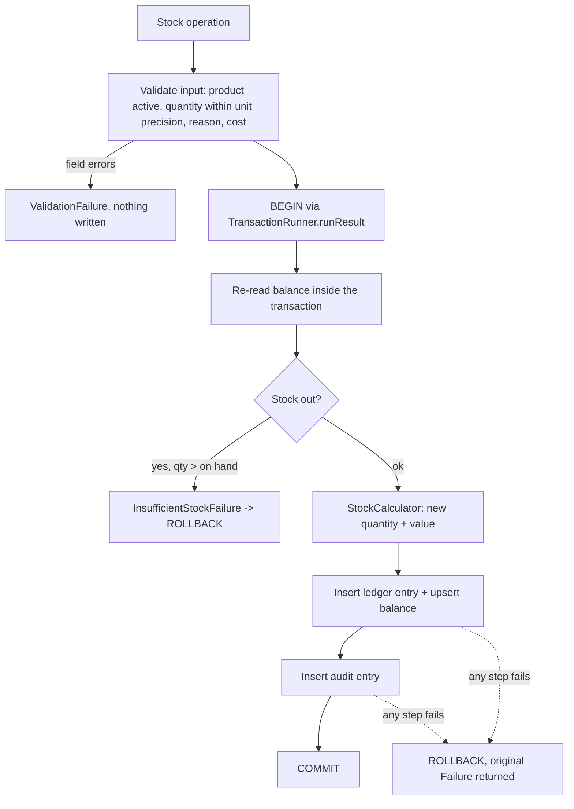

# Inventory Workflow (Phase 3)

The **stock ledger** (`stock_movements`, append-only) is the source of truth. `inventory_balances` is a projection kept in the same transaction and can always be rebuilt from the ledger.

Every repository call inside the transaction is unwrapped with `Result.getOrThrow()`, so a failed step throws, the transaction rolls back, and `runResult` returns the original typed `Failure`.

## Operations
| Operation | Movement type | Rules |
|---|---|---|
| Opening stock | `openingStock` | Once per product, and only while the product has **no** ledger entries. Cost defaults to the purchase price. |
| Stock in | `adjustmentIn` | Reason required. Cost: given unit cost, else current average cost, else purchase price. |
| Stock out | `adjustmentOut` | Reason required. Valued at the current weighted average cost. Cannot exceed stock on hand. |
| Purchases / sales / returns | `purchase`, `sale`, `purchaseReturn`, `salesReturn`, `reversal` | Posted by Phases 4-7 through the same calculator and repository. |

Archived products cannot receive stock operations (restore first).

## Weighted average cost (ADR-003)
State is `(quantity, total value)`; average cost is derived, never stored.
- **In:** `quantity += q`, `value += cost`.
- **Out:** `cogs = round_half_away(value * q / quantity)`; taking the whole quantity takes the whole value (mathematically implied, so residual rounding is absorbed by the last unit). `quantity -= q`, `value -= cogs`.
- Over any complete cycle the sum of costs out equals the sum of costs in, exactly. A randomized test (200 rounds) checks: no negative quantity or value, zero quantity implies zero value, ledger sums equal the balance, and cost conservation.
- Example: 3 units for 10.00 sold one at a time costs 3.33, 3.34, 3.33 (total 10.00).

## Statuses
`out` = quantity 0; `low` = quantity > 0 and <= reorder level (reorder level > 0); otherwise `ok`. Archived products are excluded from low/out counts, but their stock value still counts in the inventory total.

## Reconciliation
`ReconcileInventory` compares every balance with the sums of its ledger entries (quantity and value). It reports: wrong balance, missing balance row, balance with no ledger. A missing row for a ledger that nets to zero is harmless.

`RepairInventoryBalances` is an explicit, confirmed action: it rewrites mismatching balances **from** the ledger in one transaction and writes one audit entry per corrected product. It never changes the ledger, and it refuses (without writing) if a ledger nets to a negative quantity or value, which needs manual review.

## Screens
Inventory list (valuation card, search, All/Low/Out filters) -> Stock detail (balance, average cost, status, paged movement history, operation buttons) -> operation forms (`/inventory/:id/opening|in|out`). Low-stock report at `/inventory/low-stock`; reconciliation at `/inventory/reconcile`.
