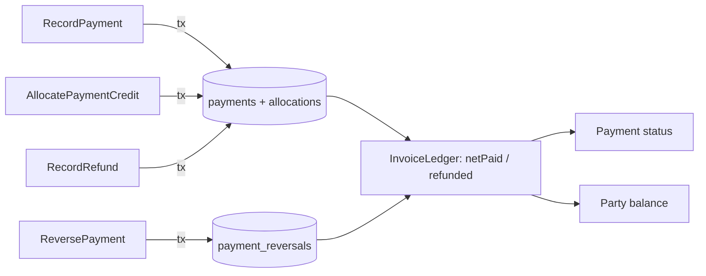

# Payments workflow (Phase 6)

## Model
- `payments` holds money received from a customer or paid to a supplier (`kind = payment`) and refunds (`kind = refund`, `refund_of_payment_id` set). Customer receipt = cash in; supplier payment = cash out; refunds go the other way.
- `payment_allocations` apply a payment to exactly one sales **or** purchase invoice. Payments allocate positive amounts, refunds negative ones (they take money back off an invoice).
- `payment_reversals` cancel a payment (one per payment). Rows are **append-only** (triggers): nothing is edited or deleted.
- Whatever is not allocated stays on the payment as **credit** and can be applied later (`AllocatePaymentCredit`) or refunded.

## Derived figures (nothing is stored)
- Invoice settlement: `netPaid = sum(active allocations)`, `refunded = sum(negative active allocations)`. "Active" = payment not reversed.
- Party balance: `opening + posted invoices - active payments + active refunds` (current currency). Positive = to collect (customer) / to pay (supplier); negative = advance.
- Payment status (`PaymentStatusCalculator`, only for posted invoices): `paid` when `netPaid >= total`; else `overdue` if the due date is before today; else `unpaid` / `refunded` (nothing paid, money handed back) / `partiallyPaid` / `partiallyRefunded`. `writtenOff` exists in the enum but is never derived (no write-off feature yet).

## Rules enforced (use case first, database as a second line)
- Amount > 0, in the configured currency; method active; party exists.
- Allocations: invoice posted, belongs to the party, same currency, each <= outstanding, no duplicate invoice, total <= payment amount. DB trigger keeps `0 <= settled <= invoice total`.
- Idempotency: one key per form; recording again with the same key returns the first payment (same request) or is rejected (different request). Reversal is unique per payment in the DB.
- Reversal needs a reason. A payment with active refunds cannot be reversed until they are. A refund cannot be reversed if the invoice it reopened was paid again meanwhile.
- Refund: reason required; <= payment amount minus earlier refunds; invoice reductions <= what the payment still settles on that invoice; the rest must fit in the payment's unallocated credit.
- Voiding a sale/purchase is refused while it has active payments (reverse them first) via `InvoicePaymentGuard`.
- Every write runs inside one `TransactionRunner` action together with the number sequence and the audit entry.

## Known limitations
- Walk-in sales (no customer) are not tracked by payments; the sale screen says so.
- Payments are recorded in the configured currency. Since Phase 11 the currency cannot change while posted invoices exist, so an invoice can never be stranded in an older currency (see `settings.md`).
- Credit allocation has no idempotency key; repeats are bounded by remaining credit and outstanding amounts and cannot over-allocate.
- `PartyBalance` for the outstanding list is computed per party (N small queries), fine for thousands of parties; revisit with a SQL aggregate if needed.

## Returns (Phase 7)
Returns lower the receivable and cash handed back through them counts as refunded; see `returns.md` for the formulas. `InvoiceLedger` and `GetPartyBalance` read them through `InvoiceReturnLookup`.
