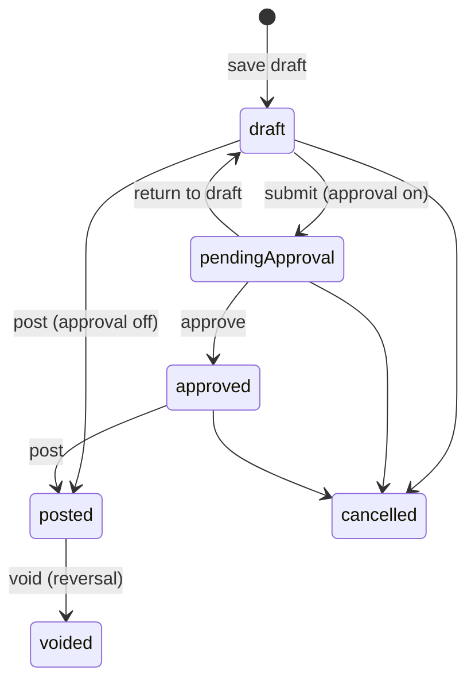

# Purchase Workflow

## Statuses

`draft → [pendingApproval → approved] → posted → voided`, and `draft | pendingApproval | approved → cancelled`.

Status rules live in one place, `DocumentStatus.canTransitionTo` (`lib/shared/domain/enums/document_status.dart`). Only **posted** purchases affect stock. Posted purchases are never edited or deleted; the database refuses it (triggers), and the only change allowed is `posted → voided`.



Approval is a setting (`app_settings.purchase_approval_required`, default off). With it on, `post` requires `approved`. A pending or approved purchase cannot be edited (return it to draft first). The toggle is in the Purchases screen menu until the Phase 11 settings screen exists.

## Saving a draft (`SavePurchaseDraft`)

Validates supplier (exists, not archived), dates (due date not before invoice date), each line (product exists and not archived; quantity positive within the unit's precision; price non-negative within the currency's decimals; discount valid), then stores header + lines in one transaction with an audit entry. **A draft never touches inventory and never consumes a document number.** Editing replaces the lines; only drafts can be edited (re-checked inside the transaction and by the database).

## Line arithmetic (`PurchaseLineCalculator`)

Integer minor units, half away from zero, each figure rounded at most once.

```text
gross    = unit price x quantity
discount = none | gross x percent (basis points) | fixed amount (<= gross)
after    = gross - discount

tax-exclusive price:  net = after,  tax = net x rate,  total = net + tax
tax-inclusive price:  total = after, net = total / (1 + rate), tax = total - net
```

`net` (value excluding tax) is the **inventory cost** of the line: tax is not part of stock value (treating tax as a cost is a future setting). Invoice totals are plain sums of the line figures, so lines always add up to the totals exactly. Each line stores snapshots: product name, SKU, unit symbol and precision, price, tax-inclusive flag, discount, tax rate and name, and all computed amounts.

## Posting (`PostPurchase`) — one transaction

1. Load the invoice; reject if already posted or not postable; if approval is required it must be approved.
2. Re-verify (`PurchaseIntegrity`): has lines, quantities positive, every line and the header totals recomputed from the stored inputs.
3. Supplier exists and is active; every product exists and is active.
4. Allocate the next number (`document_sequences`, `PUR-000001`) **inside the transaction**: a rollback does not consume it, so numbering has no gaps.
5. `markPosted`: a guarded `UPDATE ... WHERE status IN (draft, approved, ...)`. A second post matches zero rows and fails: no duplicate effect.
6. For each line, re-read the balance and apply `StockCalculator.stockIn` at the line `net`: write a `purchase` movement (`source_type = purchase_invoice`, `source_id`, `source_line_id` = line id; a unique index on these makes duplicate movements impossible) and the new balance.
7. Audit entry; commit. Any failure rolls back status, number, movements and balances together.

## Weighted average cost

Receiving `q` units at net cost `c`: `quantity += q`, `value += c`; average cost = value / quantity (see `docs/workflows/inventory.md`). Example: 10 @ 10.00 then 10 @ 20.00 → 20 units, value 300.00, average 15.00.

## Voiding (`VoidPurchase`) — compensating entries

Requires a reason. In one transaction: `markVoided` (guarded to `posted`), then for each line (last to first) a `reversal` movement removes the received quantity at its **original net cost** (`StockCalculator.removeReceived`), then an audit entry. The original document and its movements are untouched; the void is new ledger rows.

- Taking stock back at its original cost restores the average cost it had before the receipt (10 @ 10 and 10 @ 20, void the first → 10 units at 20.00).
- The cost removed is capped at the value on hand (later sales may have lowered it) and removing the entire quantity takes the entire value, so value never goes negative and zero quantity means zero value.
- If part of the received stock has already left (sold, adjusted out), the void fails with `InsufficientStockFailure` and **nothing changes**; the user fixes the stock first.
- Phase 6 must also block voiding when payments are allocated to the invoice, and Phase 7 when returns exist against it.

## Supplier payable (`GetSupplierPayable`)

`outstanding = supplier opening balance + sum(total of posted purchases)`; drafts, cancelled and voided purchases are excluded. Payments reduce it from Phase 6. Shown on the supplier detail screen.

## Deliberate Phase 4 limits

- Item-level discounts only (no invoice-level discount); the spec lists item discounts for purchases.
- Tax comes from the product's tax rate and price-includes-tax flag; it is not editable per line.
- Purchase number prefix is fixed (`PUR-`) until Phase 11 makes it configurable.
- Single currency per invoice, snapshotted from settings when the draft is created.
