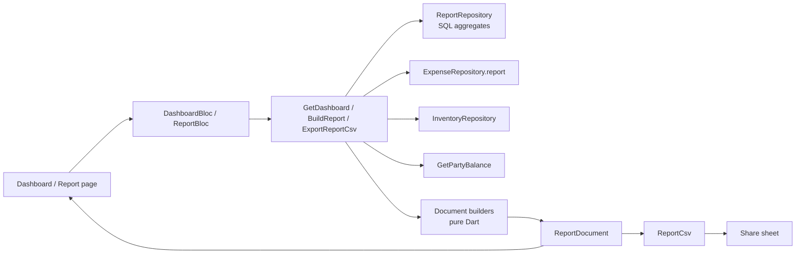

# Dashboard and Reports Workflow (Phase 9)

The dashboard and every report are **read-only views over the local database**. Nothing is cached or stored: each figure is recomputed from the posted records when the screen opens, a period changes or the user pulls to refresh. Nothing in this phase writes.

## One model, two outputs
Every report is built as a `ReportDocument`: headline metrics, optional bar charts, tables of typed cells, and the notes that explain the maths. One generic `ReportView` draws any document and `ReportCsv` encodes the same document, so **what is exported is always what was on screen** (the screen shows at most 100 rows per table; the CSV has all rows read, at most 1000, and says when it is cut).

## Rules shared by all figures (`ReportRepository`)
- Only **posted** documents count. Drafts, cancelled and voided documents never do.
- A document belongs to the period of its **document date**, a return to its **return date**, a payment to its **payment date**, an expense to its **expense date**. Dates are inclusive UTC calendar days.
- Only the **configured currency** is added up. Records in another currency are counted and mentioned in the report notes, never silently dropped.
- Money stays integer minor units. `double` is used only to place chart bars; every number shown as text comes from exact `Money`.

## Definitions
| Figure | Definition |
|---|---|
| Net sales | posted sales (excl. tax) - sales returns (excl. tax) in the period |
| Net purchases | posted purchases (excl. tax) - purchase returns (excl. tax) |
| Cost of goods sold | stock-ledger cost of `sale` movements of posted invoices in the period (voided invoices excluded) - cost of goods put back into stock by sales returns in the period |
| Gross profit | net sales - cost of goods sold |
| Operating expenses | posted expenses **excluding tax** |
| Operating result | gross profit - operating expenses |
| Inventory value | sum of inventory balances (ledger valued at weighted average cost) |
| Receivable / payable | sum of **positive** party balances (`GetPartyBalance`); credit balances are not netted |
| Cash received / paid | active (not reversed) payments and refunds with customers and suppliers, plus cash handed over at the moment of a return |

### Assumptions (also printed on the reports)
1. **Cash is not revenue.** A sale is revenue when posted, whatever has been paid. The payment report is separate and says so.
2. **Purchases are not an expense.** Stock is an asset until sold; it becomes cost through COGS.
3. COGS is the cost recorded in the ledger when the goods left, not today's cost. Returned goods that were **not** restocked stay in COGS (treated as lost).
4. Tax on expenses is assumed recoverable, so the operating result uses the amount excluding tax; the expense report shows both net and total paid. Revisit before commercial use in a jurisdiction where it is not.
5. Profit figures are **estimates for management**, not accounting statements.
6. Stock movement dates are UTC timestamps: an adjustment made late in the evening in a UTC+ time zone can appear under the previous day.

## Reports
| Report | Period | Filters | Source |
|---|---|---|---|
| Sales | yes | customer | `sales_invoices`, `sales_returns` |
| Purchases | yes | supplier | `purchase_invoices`, `purchase_returns` |
| Inventory | as of now | - | `InventoryRepository.listStock` (archived products included, so the total equals the ledger value) |
| Stock movements | yes | product | `stock_movements` |
| Low stock | as of now | - | `listStock(lowOrOut)` |
| Product performance | yes | product | invoice lines, return lines, ledger |
| Customer / supplier outstanding | as of now | - | `GetPartyBalance.outstanding` (same figures as the Phase 6 screens) |
| Payments | yes | customer, supplier | `payments`, `payment_reversals`, return refunds |
| Expenses | yes | - | `ExpenseRepository.report` |
| Profitability | yes | - | `GetProfitFigures` (also used by the dashboard) |

Reconciliation: the sales report's net sales equals the profitability report's net sales and the dashboard's; product performance's net revenue sums to net sales when every invoice total is the sum of its lines (true for all documents this app creates); the chart bars sum to the report's net figure (tested).

## Dashboard
Period figures (net sales, net purchases, expenses, gross profit, operating result, net cash) follow the chosen period (today, this month, last month, last 30 days, this year, custom). "Right now" figures (inventory value, low/out of stock, customers owe, you owe suppliers) do not. Charts: sales vs purchases (grouped bars; daily up to 31 days, monthly beyond), net-sales running total (line), where the money went (net sales, cost of goods sold, expenses, operating result as ranked bars), expenses by category (donut), top five products by net revenue, stock health (healthy / low / out of stock donut) and cash and balances (received, paid, customers owe, you owe). Extra tiles: gross margin, average sale, returns, tax collected. The five newest sales and purchases are listed. A fresh install shows the welcome state; pull to refresh or the refresh button reloads. Presets are re-evaluated against today on every reload, so a long-open app moves to the new day or month.

## Export
CSV only (UTF-8 with BOM, CRLF, RFC 4180 quoting). Text cells starting with `=`, `+`, `-`, `@`, tab or CR get a leading apostrophe against spreadsheet formula injection; numeric cells are written plainly (negatives keep their `-`). The file goes to the temporary folder and opens the system share sheet. PDF export is not included.

## Limits
- Tables read at most 1000 rows (newest first); totals always cover every record.
- Outstanding reports compute each party's balance one by one: fine for a small business, revisit in Phase 12 for thousands of parties.
- The dashboard does not refresh by itself when other tabs record data; use pull to refresh.
