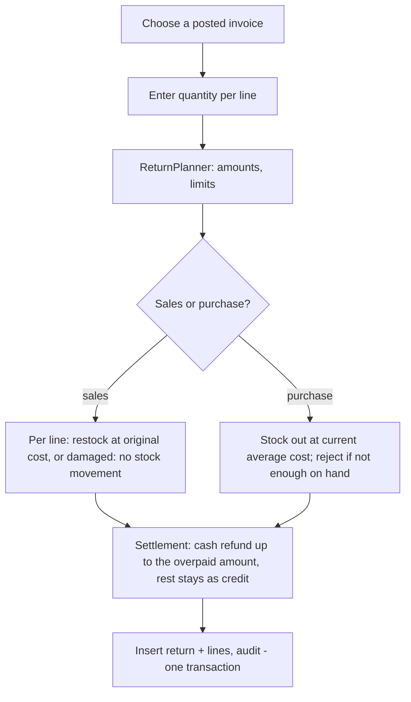

# Returns Workflow

A return is its **own numbered document** (`SRN-000001` for sales returns, `PRN-000001` for purchase returns). It is created and posted in one step, is never edited or deleted, and never touches the original invoice. Its value is a **credit note**: it lowers what the customer owes us (sales) or what we owe the supplier (purchase).



## Rules
- Only **posted** invoices can be returned. An invoice that has returns can no longer be **voided** (use case guard `InvoiceReturnGuard` + a database trigger): a return is final.
- `returnable = invoiced quantity − Σ earlier returns of that line`. More is rejected in the use case and again by a database trigger (quantity, net and tax).
- **Amounts.** The value of a returned part is the same share of the invoice line's *net* and of its *tax*, rounded once. The return that completes a line takes the exact remainder and no return can take more than what is left, so the returns of a line never add up to more than the line (no rounding drift, tax included).
- **Sales return, restock.** Per line the user chooses *put back in stock* (default) or not (damaged). A restocked line enters stock as a `salesReturn` movement at the cost the goods left with (from the original `sale` movement, by the same share and the same completion rule), so average cost stays honest. Not restocked: no movement; the original cost of goods sold stays as it was.
- **Purchase return.** Always leaves stock, as a `purchaseReturn` movement at the *current* average cost. If less is on hand than is being returned, the whole return fails with `InsufficientStockFailure` and nothing changes. (Any difference between the credited price and the average cost is not tracked separately.)
- **Settlement.** `credit = total − cash refund`.
  - The **cash refund** (money handed back to the customer / received from the supplier) is limited to money paid beyond what is still owed after this return: `min(total, cashHeld − (receivable − total))`. Default is none; the form offers "Maximum".
  - A return of a **walk-in sale** has no account to credit, so the whole value is handed back (method required).
  - The remainder stays as credit: it reduces the invoice's outstanding amount, and if the invoice is already paid it becomes a credit on the customer/supplier balance.
- Idempotency: the form generates a key; posting the same key again returns the first return and has no second effect.
- Everything is re-validated inside the transaction; the UI preview uses the same `ReturnPlanner`, so what the user sees is what is posted.

## Effect on payments and balances
`InvoiceLedger` and `GetPartyBalance` read return totals through the shared `InvoiceReturnLookup` contract (so `payments` does not depend on `returns`):

```
receivable  = invoice total − returned
cashHeld    = payments − payment refunds − cash handed back through returns
outstanding = max(0, receivable − cashHeld)        credit = max(0, cashHeld − receivable)
party balance = opening + invoiced − returns − payments + refunds + return refunds
```
Payment status is derived from `receivable`/`cashHeld`; cash handed back through a return counts as refunded.

## Not in Phase 7
- Voiding a return (returns are final; there is no "undo").
- Returns of invoices in another currency than the invoice's own are fine (amounts use the invoice's currency), but their party balance follows the Phase 6 rule (current currency only).
- Writing returns into reports/dashboard (Phase 9 reads them).
