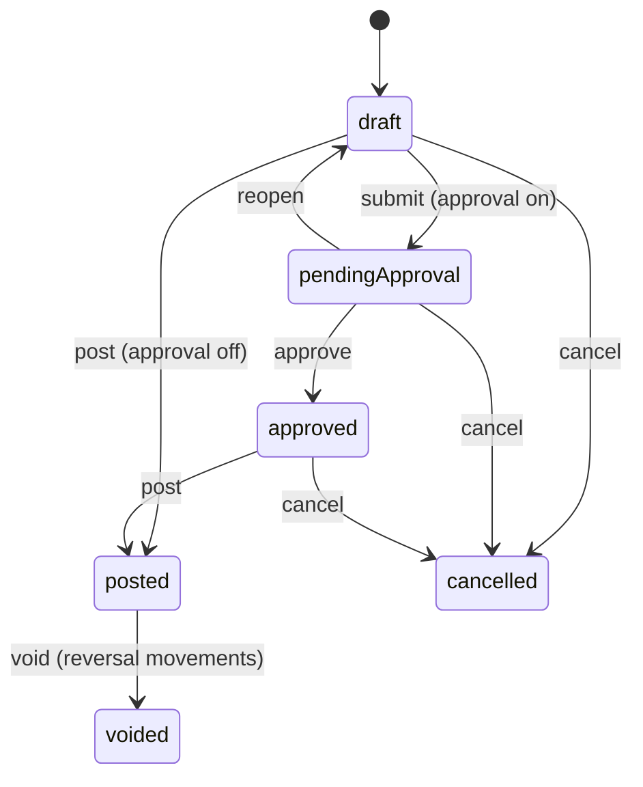

# Sales Workflow

Sales mirror purchases (same `DocumentStatus` model, same numbering and audit mechanics) with stock leaving instead of entering.

## Customer
A sale may have **no customer** (walk-in / cash sale): `customer_id` is NULL and `customer_name` holds `Walk-in customer`. A chosen customer is snapshotted by name; archived customers are refused at save and at post.

## Drafts and stock availability
Drafts never touch stock or consume a number. When a draft is **saved**, the quantities are checked against stock on hand **cumulatively per product** (two lines of 6 for 10 in stock fail on the second line) so the user sees the shortage next to the line. This is advisory: posting re-checks inside its transaction.

## Posting (single transaction)
1. Load invoice; check status is postable (and approved when approval is on).
2. Re-check totals against the lines (`SalesIntegrity`).
3. Validate customer (if any) and every product (not archived).
4. Allocate the gap-free number `INV-000001` (rolled back with everything else).
5. Mark `posted`.
6. For each line: **re-read the balance**, `StockCalculator.stockOut` (rejects negative stock with `InsufficientStockFailure` naming the product), insert a `sale` movement (negative quantity, negative cost = quantity x current weighted average cost), update the balance.
7. Audit entry; commit. Any failure rolls back status, number, movements and balances together.

Cost of goods sold is the weighted average cost at posting (ADR-003); average cost is unchanged by a sale. It is read from the ledger (`stock_movements.total_cost_minor`), not stored on the invoice line, so there is one source of truth.

## Void
`posted` -> `voided` only, with a mandatory reason, through compensating `reversal` movements: each line goes back into stock **at the cost recorded on its original `sale` movement**, so stock value is restored exactly even if the average cost changed meanwhile. The posted document and original movements are untouched. Phase 6/7 will additionally block voiding when payments or returns are linked.

## Snapshots
Each line stores product name, SKU, unit symbol/decimals, quantity, price, price-includes-tax flag, discount, tax name/rate/amount and totals; the header stores currency and the customer name. Product, customer, price and tax edits never change a saved invoice.

## Invoice PDF and sharing
`InvoiceLayout` (pure domain) turns the stored invoice + business profile into the exact text printed. `PdfInvoiceRenderer` (data layer, `pdf` package) only lays it out; `SharePlusInvoiceFileSharer` writes a temp file and opens the system share sheet. Because the PDF comes from the stored invoice, it always matches it. Only posted or voided invoices can be shared (voided ones carry a VOID banner). Amounts print with the ISO currency code (for example `INR 1,180.00`) because the built-in PDF fonts lack the rupee sign. The on-screen detail page is the invoice preview.

## Receivable
`outstanding = customer opening balance + posted sales` (voided/cancelled/draft excluded). Payments reduce it from Phase 6.
